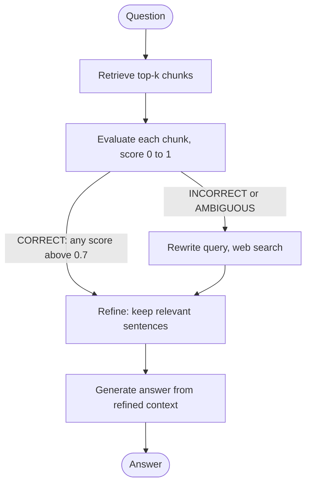

# Corrective RAG (CRAG) with LangGraph

My implementation of **Corrective Retrieval Augmented Generation** using LangGraph, FAISS, Gemini embeddings, Groq-hosted LLMs and Tavily web search, with a plain RAG notebook as a baseline.

Based on: Yan et al., *Corrective Retrieval Augmented Generation* (2024), [arXiv:2401.15884](https://arxiv.org/abs/2401.15884).

## Motivation

Plain RAG trusts whatever the retriever returns. If the retrieved chunks are irrelevant, the model answers from bad context. CRAG adds a check after retrieval and corrects course. I built it step by step to understand how each part changes the answer.

## What I built

- A baseline RAG pipeline (retrieve, then generate).
- A retrieval evaluator that scores each retrieved chunk for relevance.
- Sentence-level refinement that keeps only the sentences useful for the question.
- Query rewriting and Tavily web search as a fallback when local retrieval is weak.
- A LangGraph graph that routes between these steps based on the evaluator's verdict.

## Pipeline



| Verdict | Condition | Action |
|---|---|---|
| CORRECT | at least one chunk scores above 0.7 | refine the good internal chunks |
| INCORRECT | no chunk scores above 0.3 | rewrite query, search the web, refine web results only |
| AMBIGUOUS | in between | rewrite query, search the web, refine internal and web results together |

## Notebooks

| Notebook | What it is |
|---|---|
| `notebooks/01_basic_rag_baseline.ipynb` | Plain RAG: retrieve, then generate. The baseline. |
| `notebooks/02_corrective_rag.ipynb` | Full CRAG pipeline with evaluator, refinement, query rewriting and web search. |

## Setup

```bash
git clone https://github.com/maheksayyed19/corrective-rag-langgraph.git
cd corrective-rag-langgraph
python -m venv .venv
# Windows: .venv\Scripts\activate      macOS/Linux: source .venv/bin/activate
pip install -r requirements.txt
cp .env.example .env      # Windows: copy .env.example .env
```

1. Add your keys to `.env`: `GOOGLE_API_KEY`, `GROQ_API_KEY`, `TAVILY_API_KEY`.
2. Put one or more PDFs in `documents/`.
3. Run `jupyter notebook` and open a notebook from `notebooks/`.
4. Edit the question in the last cell and run all cells.

## Differences from the paper

- The retrieval evaluator is an **LLM judge** that returns a relevance score per chunk. The paper trains a small T5 evaluator.
- Sentence-level filtering is also done by an LLM (one keep/drop decision per sentence), not by a trained model.
- Thresholds (0.7 and 0.3) are fixed values I chose, not tuned.

## What I learned

- How to build a conditional multi-step pipeline in LangGraph, with shared state and routing between nodes.
- Why checking retrieval quality matters: a RAG system can fail silently when the retriever returns weak chunks.
- How to work within free-tier API limits: separate models for cheap and expensive steps, retries, and limited concurrency.

## Limitations and future work

- Answer quality depends on the LLM judge, which I have not validated against human judgments.
- Refinement makes one LLM call per sentence, so it is slower than plain RAG.
- Free-tier rate limits on Groq can slow or interrupt runs.
- Next step: a small quantitative comparison of the baseline and CRAG on a fixed question set.

## Tech stack

Python, LangGraph, LangChain, FAISS, Google Gemini embeddings (`gemini-embedding-001`), Groq (`openai/gpt-oss-120b` for answers, `openai/gpt-oss-20b` for scoring, filtering and query rewriting), Tavily.